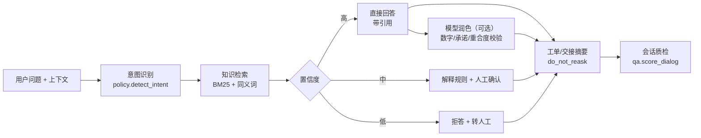

# 架构与设计取舍

## 目标 / 非目标

**目标**

- 回答必须能指回知识条目，不能自由发挥；
- 涉及资金、账号安全、人身安全的诉求，机器人只解释规则、收材料、建工单，最终由人确认；
- 转人工时带上上下文，用户不重复描述；
- 能对已有会话做质检，找出“该转没转、越权承诺、重复询问”。

**非目标**

- 不替代人工坐席的最终裁决；
- 不做情绪识别模型、不做声纹/图像；
- 不做实时坐席辅助（路线图）。

## 数据流

## 决策矩阵

| 条件 | 动作 |
| --- | --- |
| 置信度 ≥ 0.70 且非高风险意图 | `answer` |
| 置信度 0.52–0.70 | `answer_with_human` |
| 置信度 < 0.52，或 other 意图且分数 < 8 | `refuse_and_escalate` |
| 退款/赔偿/价格/合同/账号/客诉/法务 | `answer_with_human` |
| 问候、过短输入 | `clarify` |

阈值在 `policy.py`，可按业务调整；调整后必须重跑 `scripts/run_evals.py`。

## 知识库模型

每条知识是 Markdown + front-matter：

| 字段 | 作用 |
| --- | --- |
| `id` | 引用标识，回复里出现 `依据：kb-xxx` |
| `question` / `answer` | 检索与引用原文；answer 必须是最小事实 |
| `scope` | 适用口径，避免把特殊商品规则套到全品类 |
| `effective_from/to` | 生效区间，过期知识不参与回答 |
| `owner` | 出问题找谁 |
| `risk` | `high` 的知识必须有例外/边界描述，否则 lint 报警 |
| `tags` | 检索辅助 |

启动时校验：缺 id、缺 answer、有效期倒挂、同题冲突、高风险无边界，都会在 `--lint` 中列出。

## 三个关键决定

### 1. 引用优先于流畅

`Answer.citations` 是结构化字段，不是字符串拼接。没有引用就不允许直接回答，避免“听起来对但没有依据”。

### 2. 数字必须溯源

回复里的“3 个工作日”“7 天”“30 天”必须能在引用原文中找到，否则降级为人工确认。这一条专门对付模型改写时把 5 天写成 3 天。

### 3. 交接要带“不要重复问”

`Ticket.do_not_reask` 记录用户已提供的订单号、账号、手机号等，人工接手后不再盘问。这既是体验问题，也是新国标“信息同步”的要求。

### 4. 模型只改措辞，不改决策

`SupportAgent` 先完成意图识别、检索、置信度判断、工单生成，再把“已命中的知识答案”交给模型润色。模型拿到的是脱敏后的问题、知识标题、规则答案和动作；拿不到工单写权限，也不能选择引用。

`llm.validate_polish()` 做三道校验：承诺词、数字溯源（含数字集合比对）、与知识原文的词元重合度。任何一道不过，`_polish()` 回退原文，并把原因写进 `Answer.notes`。这样模型调用失败、超时、返回空、跑题、编数字、越权承诺，都不会改变最终事实。

意图对齐重排（`INTENT_KB_PREFIX`）只影响“哪条知识排第一”，不参与置信度计算——置信度仍用原始 BM25 分，避免把零证据的查询抬成可答。

## 失败模式与处理

| 失败 | 表现 | 当前处理 |
| --- | --- | --- |
| 同义词缺口 | “几点上班”搜不到“服务时间” | 同义词表扩展 + 评测用例回归 |
| 知识冲突 | 两条规则给出不同退款天数 | lint 报冲突，禁止上线 |
| 知识过期 | 活动规则已结束仍被引用 | 按 `--date` 过滤生效区间 |
| 模型编数字 | 5 天写成 3 天 | 数字溯源校验，失败降级人工 |
| 模型调用失败/超时 | 回复为空或卡住 | 20 秒超时，回退规则答案并写明原因 |
| 模型跑题 | 新增知识外内容 | 词元重合度 + 数字校验，失败回退原文 |
| 该转没转 | 用户已表达投诉/安全风险 | 强制人工意图 + 质检扣分 |
| PII 入日志 | 手机号、地址进入工单 | `mask_pii` 脱敏后再写入 |

## 扩展点

- **新增知识**：在 `data/kb/` 加 Markdown，跑 `--lint`，再跑评测确认没有挤掉原有命中；
- **新增意图**：在 `policy.INTENTS` 加关键词与 `human_required`；
- **替换检索**：`bm25.py` 可换成向量检索，但必须保留 `Citation.id` 与分数，否则降级逻辑失效；
- **新增质检规则**：在 `qa.score_dialog` 加扣分项，并在 README 说明分值。
